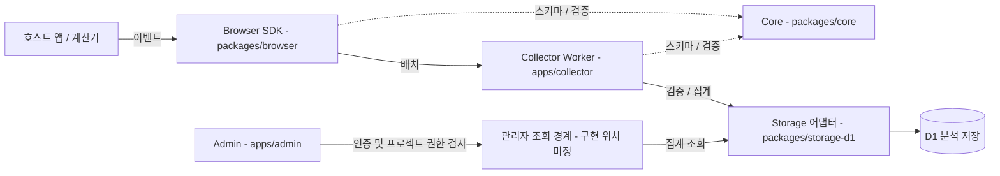

# 아키텍처 — Tallyfin

상태: Draft / 초기 계획. 구현 없음. 아래 흐름은 계획입니다.

## 흐름

## 구성 요소와 소유권

- `packages/core` — 스키마/검증/코호트. 사설 ZDP나 Cloudflare 의존성 없음.
- `packages/browser` — 브라우저 SDK. 외부 런타임 의존성 없음.
- `packages/storage-d1` — D1 어댑터. 분석 저장의 소유자.
- `apps/collector` — Cloudflare Worker. 네이티브 fetch, 프레임워크 없음.
- `apps/admin` — 프레임워크 미정.
- Sembom 전용 호스트 어댑터는 Sembom 저장소에 둡니다. 엔진 복사를 두지 않습니다.

## 실패 격리

- 수집/전송 실패는 계산기 렌더링이나 계산에 영향을 주지 않습니다.
- 전송은 비동기이며 렌더링/계산을 대기시키지 않습니다.
- Worker 메모리에 내구성 카운터를 두지 않습니다.

## 경계

- zdp-data-platform은 내부 분석 통합 계약을 소유하고, zdp-platform-observability는 인프라 텔레메트리를 소유합니다. Tallyfin의 코어에는 두 저장소의 비공개 패키지 의존성을 추가하지 않습니다.

자세한 계약은 [명세](./docs/product/02-spec.md), 결정 기록은 [ADR 0001](./docs/adr/0001-initial-architecture-boundaries.md)을 봅니다.
