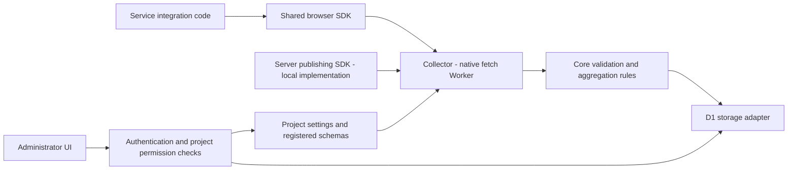

# Architecture

Status: Core functionality is implemented and verified locally. The repository contains `packages/core`, `packages/storage-d1`, `apps/collector`, `packages/browser`, `packages/server`, and the React/Vite administrator app `apps/admin`. The administrator provides project creation, settings, schema publishing, administrator and publisher permissions, change history, analytics, funnels, and CSV. A real identity provider, remote D1, production deployment, and service pilot have not been connected yet. Current sequencing follows the [roadmap](docs/product/01-roadmap.md).

The browser SDK sends batches of events that a service explicitly submits. It fetches project settings and an immutable schema snapshot, and the core validates them. The storage adapter applies receipts, attempts, quotas, and daily aggregates in one transaction. Administrator queries read aggregates on the same project, version, and timezone basis. Shapes follow [OpenAPI](./api/openapi.yaml) and [DBML](./db/schema.dbml), while meaning follows the [event contract](./docs/backend/event-contract.md).

Each project's definitions, permissions, and aggregates are isolated. Settings changes and queries pass administrator authentication and project permission checks. Collection applies the target project's active state, registered schema, source, and quotas, and never places an administrator token in the browser. A public project ID and allowed origins do not replace authentication or bot prevention. Server publishing authentication uses a dedicated publisher bearer audience, separate from administrators, and its own runtime configuration.

The shared SDK and core do not include calculator events or a consumer service's engine. Service-specific integration code stays in each service repository. `packages/core`, `packages/storage-d1`, `apps/collector`, `packages/browser`, and `packages/server` have completed local implementation and verification, with an integration example under `examples/sembom`. `apps/admin` has moved to the React/Vite administrator app, and production deployment is a follow-up. Administrator ownership boundaries follow [ADR 0007](docs/adr/0007-admin-application.md). Local Node, Worker, and D1 integration for the server publishing SDK has also been verified. Other storage adapters and deployment with a real provider and remote database are follow-up work.

The initial technical direction is TypeScript, a browser SDK with no external runtime dependencies, a native-fetch Worker, and a separate D1 storage adapter. Core and SDK code take no dependency on Cloudflare or private ZDP packages. Daily aggregates come first, and Worker memory is not used for persistent storage. Collection failures do not block a service's UI or business processing.

Project registration does not bypass privacy limits. Incompatible versions and sources are not mixed. The v0.1 API and logical database contract and their implementation can be checked in OpenAPI, DBML, and the [validation record](VALIDATION.md). Tools exist for installation configuration generation, public provider checks, remote database metadata checks, and administrator access checks, but they have not been run with real production configuration.

Related: [product specification](./docs/product/02-spec.md), [browser SDK](./docs/backend/browser-sdk.md), [administrator query boundary](./docs/backend/administrator.md), [general product decision](./docs/adr/0004-general-product-analytics.md), [privacy](./docs/adr/0003-minimal-privacy-preserving-events.md), [package boundaries](./docs/monorepo/workspace-boundaries.md).
