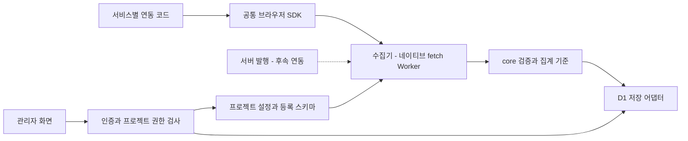

# 아키텍처

상태: 부분 구현. `packages/core`·`packages/storage-d1`·`apps/collector`를 로컬에서 구현·검증했고, `packages/browser`·`apps/admin`·`examples/sembom`와 운영 배포는 아직 없다.

브라우저 SDK는 서비스가 명시적으로 보내는 이벤트를 배치 전송한다. 프로젝트 설정과 불변 스키마 스냅샷을 조회하고 코어가 검증한다. 영수증·시도·할당량·일별 집계를 저장 어댑터가 한 트랜잭션으로 반영한다. 관리자 조회는 같은 프로젝트/버전/시간대 기준의 집계를 읽는다. 형태는 [OpenAPI](./api/openapi.yaml)·[DBML](./db/schema.dbml), 의미는 [이벤트 계약](./docs/backend/event-contract.md)을 따른다.

각 프로젝트의 정의·권한·집계는 분리한다. 설정 변경과 조회에는 관리자 인증과 프로젝트 권한 검사를 적용한다. 수집에는 대상 프로젝트의 활성 상태·등록 스키마·출처·한도를 적용하며 브라우저에 관리자 토큰을 넣지 않는다. 공개 프로젝트 ID와 허용 오리진은 인증이나 봇 방지를 대신하지 않는다. 서버 발행 인증은 후속 계약에서 정한다.

공통 SDK/코어에는 계산기 이벤트나 소비 서비스의 엔진을 넣지 않는다. 서비스별 연결 코드는 각 서비스 저장소에서 관리한다. `packages/core`·`packages/storage-d1`·`apps/collector`는 로컬 구현·검증을 마쳤고, `packages/browser`·`apps/admin`·`examples/sembom`는 계획된 경계다. 서버 SDK와 다른 저장 어댑터는 후속 구현이다.

초기 기술 방향은 TypeScript, 외부 런타임 의존성 없는 브라우저 SDK, 네이티브 fetch Worker와 별도 D1 저장 어댑터다. 코어/SDK에는 Cloudflare나 비공개 ZDP 패키지 의존성을 넣지 않는다. 일별 집계를 우선하고 Worker 메모리를 영속 저장으로 쓰지 않는다. 수집 실패는 서비스 화면·업무 처리를 막지 않는다.

프로젝트 등록으로 개인정보 제한을 우회하지 않는다. 호환되지 않는 버전·출처는 섞지 않는다. v0.1 API·논리 DB 계약을 확정했고 코어 검증·D1 원자 저장·최소 브라우저 수집기를 로컬에서 구현·검증했다. 실제 관리자 인증·조회와 운영 배포는 아직 구현하지 않았다.

관련: [제품 명세](./docs/product/02-spec.md), [범용 제품 결정](./docs/adr/0004-general-product-analytics.md), [프라이버시](./docs/adr/0003-minimal-privacy-preserving-events.md), [패키지 경계](./docs/monorepo/workspace-boundaries.md).
