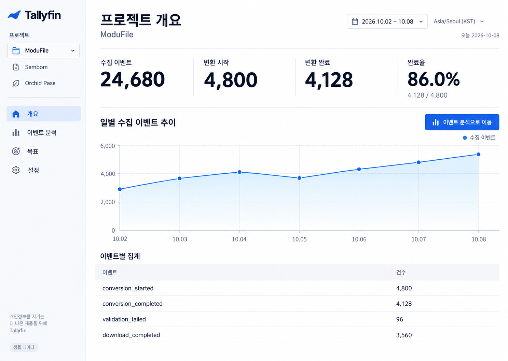

# Selected Design Criteria

This is the project overview mockup selected by the user on 2026-10-08. The original was saved as a reference image. The font sizes and colors below are starting values for implementation and are not precise measurements from the image. A runnable sample UI has been implemented in the [admin prototype](../../prototypes/admin/README.md).

## Confirmed Screen
- Bright white/off-white background with a calm cool-blue sidebar on the left.
- The Tallyfin symbol (blue fin/wave) and a bold black wordmark.
- Project selector and adjacent project links: ModuFile, Sembom, Orchid Pass.
- Navigation: Overview, Event Analytics, Goals, Settings.
- A wide right-hand workspace, with the screen title in the upper left and the period and time zone in the upper right.
- The four open metrics are displayed as large black numbers, separated by vertical hairlines, and are not wrapped in individual cards. Completion rate displays both numerator and denominator.
- A full-width chart with a blue line and a pale blue area.
- Below, an event table with a light-background header, with rows separated by hairlines.
- Use flat surfaces and subtle corners of about 6px, and avoid excessive borders/shadows/card nesting.

## Initial Token Candidates
| Item | Value |
|---|---|
| Primary accent | #155EEF |
| Page | #FFFFFF |
| Navigation | #F8FAFC |
| Body | #0F172A |
| Secondary text | #64748B |
| Divider | #E2E8F0 |

Use a minimum of 16px for body/table/chart labels (target 16-18px), 32-36px for headings, and 40-48px for KPIs. The sidebar is about 240px, desktop main padding is 32-40px; do not fix the entire screen, and keep it responsive. The values above must be checked against the image during implementation, and the font stack/framework/icons/chart library are still undecided.

## Criteria to Follow
- Maintain the selected mockup's hierarchy, spacing, and readability.
- Navigation and project switching must actually work.
- Do not hard-code ModuFile conversion fields into the general UI. Exposed metrics and the event table follow project settings.
- The metrics/dates in the capture are fictional, and 2026.10.02-10.08 is not an actual default. Series and aggregates must match in the prototype.
- Do not include fake real-time status; use only sample labels until the real backend is available.
- Mobile 320px: collapsible drawer, metric grid wrapping, and tables that scroll horizontally without reducing text size.
- Check keyboard/selection state/focus/contrast during implementation.

Handling for missing/unknown/loading/error/stale/no-permission states follows [FRONTEND_DESIGN.md](./FRONTEND_DESIGN.md), and do not add unique-user analytics, advanced funnels, or user identification features to the initial scope. For the product specification, refer to [02-spec.md](../product/02-spec.md).

The sample UI follows the mockup's open metrics, sidebar, line chart, and table structure, and adds numeric views and status checks that were not in the mockup. The actual implementation uses a 44px title and 56px metrics and reduces them on mobile. Comparison and verification results are recorded in [Design QA](../../prototypes/admin/design-qa.md).